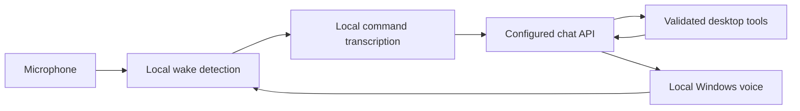

# ULTRON · JARVIS interface

A Windows voice assistant with a luminous animated sphere, smooth blue controls, a dedicated
conversation panel, local wake detection, local transcription, local synthetic speech, and
configurable cloud intelligence. Connection and privacy preferences live in a separate settings window.

## Open

From this project folder in PowerShell:

```powershell
.\.venv\Scripts\python.exe -m ultron
```

The app starts listening automatically. Say **Hey computer**, wait for the acknowledgement tone,
then speak your command. It returns to wake listening after every response, including after a failed
cloud request. You do not need to press a button for each conversation. The microphone closes while
processing and speaking so the app does not hear its own response.

**Pause listening** stops listening and cancels queued commands. **Resume listening** enables it
again. Text input and quick commands remain available when muted; typed commands can also be queued
while the voice listener is running. Closing the window exits the assistant. This version does not
register itself to start at Windows login.

## Connect your AI provider once

1. Open **Connection settings** (or **Connection** in the sidebar), then choose **Gemini 4 Argon**,
   **NVIDIA Nemotron**, **OpenAI**, or **Custom compatible API**.
2. Enter that provider's API key, base URL, and model ID.
3. Use **Test connection** to check access without running desktop actions.
4. Choose **Save connection**. Leave **Listen automatically on launch** enabled.

The Gemini preset uses `https://generativelanguage.googleapis.com/v1beta/openai` and `gemini-4-argon`.
The NVIDIA preset uses `https://integrate.api.nvidia.com/v1` and
`nvidia/nemotron-3.5-lightning-30b-a3b`. The OpenAI preset uses `https://api.openai.com/v1` and
`gpt-6-luna`. All model IDs are editable. Custom APIs must implement OpenAI-compatible
`POST /chat/completions`, bearer authentication, and a compatible response schema. The provider
must permit the selected model. A key for one provider cannot authenticate with another provider.

The OpenAI Luna preset uses no reasoning, low verbosity, strict tool arguments, and a 512-token
completion cap for short voice interactions. Existing saved model IDs are preserved: choose the
OpenAI preset again and save to adopt Luna (switching provider clears the unsaved key field).
Models that require Responses for tools, such as GPT-6.1 Sol, are rejected before a chat tool request;
this app currently implements Chat Completions only. Gemini Argon uses low thinking with the existing
2,048-token spend cap; Nemotron keeps thinking disabled. Truncated responses are reported as errors,
never accepted as completed answers or dispatched as tools. Hard explanations may need another
model or a larger, explicitly tested budget.

Switching provider clears the unsaved key field. Changing provider/model settings takes effect after
you save. Some chat models do not support tool calling: disable **Enable desktop tools** to use
conversation only. Local compatible servers can use an HTTP localhost base URL with an optional key;
remote providers require HTTPS. The app does not forward credentials through HTTP redirects.

**Remember encrypted key** stores it encrypted by Windows DPAPI for your current Windows account.
Preferences live at `%APPDATA%\Ultron\settings.json`. Uncheck Remember and save to remove the stored
key. The key is masked in the interface and is not included in source files or GitHub commits.
The optional environment variables `GOOGLE_API_KEY`, `NVIDIA_API_KEY`, `OPENAI_API_KEY`, and `ULTRON_MODEL` supply
initial defaults when no saved configuration exists.

## Things to say

- “Open calculator.”
- “Open Visual Studio Code.”
- “Open file explorer.”
- “Search the web for FIR filter tutorials.”
- “Turn the volume down.”
- “Pause the music.”
- “Explain interrupts and polling in three sentences.”

Supported apps: Notepad, Calculator, Explorer, the default browser, VS Code, Chrome, Edge, Spotify.
They must already be installed. Search opens results in the browser; it does not read their content.
Media controls send Windows media keys; mute toggles the current mute state.

The Calculator, Files, and Browser buttons run their explicit, validated local app action without
contacting an AI provider. They respect Enable desktop tools, cancellation, and the command queue.
Typed and spoken natural-language requests still use the configured model.

## Audio and privacy

Wake recognition and command transcription use the installed small English Vosk model. Voice replies
use an installed Windows desktop voice, preferring Microsoft David. No OpenAI speech key is needed
when using NVIDIA or a custom provider. The voice is synthetic, not an actor's voice recreation.

Ambient audio and command clips stay on your device and are not saved. Only recognized text, recent
conversation turns, and desktop tool results are sent to the selected AI provider. Provider data
retention and usage charges follow that provider's policies. The conversation is held in memory.
Conversation history is limited to six turns and 24,000 serialized characters, evicting whole turns.
Individual requests are limited to 8,000 characters, tool sequences to four model rounds and eight
tool calls, and provider response bodies to 1 MiB. These are resource bounds, not spending guarantees.

The default wake phrase is **Hey computer** because those words are in the speech model vocabulary.
A dependable “Ultron” or “Jarvis” trigger requires a suitable custom wake model or pronunciation
support. This is phrase recognition, not speaker authentication; nearby voices may activate it.

## Architecture



Command capture ends after approximately 1.3 seconds of silence or 12 seconds total. If no speech
starts within five seconds, the app returns to wake listening. Stop prevents new tool execution
after a pending API response returns; actions already dispatched to Windows cannot be undone.
Speech playback is interruptible by mute. A pending HTTP request can take up to 60 seconds to finish.

The assistant opens apps and controls media. It does not yet inspect screens, click inside apps,
type documents, send messages, modify files, or execute arbitrary commands. Tool arguments are
validated locally. It offers only the explicitly implemented actions to the model.

## Fresh installation

Requires Windows x64, Python with Tkinter, a microphone supporting 16 kHz mono, and a Windows desktop
speech voice. The local installation uses Python 3.14.

```powershell
python -m venv .venv
.\.venv\Scripts\python.exe -m pip install -r requirements.txt
.\.venv\Scripts\python.exe -m ultron.setup_model
.\.venv\Scripts\python.exe -m ultron
```

If you have UV, you can install with:

```powershell
uv pip install --python .\.venv\Scripts\python.exe -r requirements.txt
```

## Troubleshooting

- **Microphone unavailable:** enable desktop microphone access in Windows privacy settings and select
  a working default input in Windows Sound settings. The app retries its listener after input errors.
- **Wake model missing:** run `python -m ultron.setup_model` using the virtual environment.
- **Poor recognition:** wait for the tone, speak clearly, and use a headset. The small local model
  trades accuracy for low resource use. The 16-bit PCM voice threshold in `audio.py` defaults to 450;
  microphone gain and room noise may need tuning.
- **No spoken replies:** enable Speak replies, and install a Windows desktop voice. The text response
  remains visible if speech fails.
- **Provider error:** check that the key, endpoint, and model ID match. Test connection. If the model
  rejects tools, disable desktop tools and save. The conversation stream shows the error.
- **Saved settings unavailable:** enter the connection again; encrypted keys are bound to your account.

## Verification

```powershell
.\.venv\Scripts\python.exe -m unittest discover -s tests -v
```

62 tests cover transport/provider routing, Gemini payload handling, credential isolation, tool feedback, cancellation, continuous recovery,
conversation retention, wake matching, audio format, provider switching, typed command queuing,
automatic listening startup, settings dialog behavior, and UI layout at default/minimum sizes. Cloud calls and desktop actions
are mocked. A local smoke test also verified wake recognition and command transcription using
synthetic Windows audio, and encrypted settings round-trip with a fake key. The interface was
visually inspected. No real provider key was used; actual provider access and recognition of your
voice require your configuration and microphone test.

Additional offline checks verify outgoing strict schemas, model compatibility, truncated responses,
malformed and duplicate tool-call IDs, local argument validation, history bounds, reasoning removal,
usage accounting, and local quick buttons. See [measures and remaining risks](docs/prompt-review.md).

`Cloud.last_metrics` holds the latest operation's request count, attempted action count, aggregate
input/output tokens, cached/reasoning token details when supplied, cumulative request time, and total
cloud-operation time. It stores no transcript or key. `usage_complete: false` means totals are partial
or unavailable; absent token details are `null`. Timings exclude transcription and speech playback.
Metrics are in memory and are not sent anywhere or written to a log automatically.

This is a regular Windows Python app; no Pinokio launcher files were created or changed.

## References

- [Google Gemini OpenAI-compatible chat API](https://ai.google.dev/gemini-api/docs/openai)
- [NVIDIA Nemotron chat API](https://docs.api.nvidia.com/nim/reference/nvidia-nemotron-3-5-lightning-30b-a3b-infer)
- [NVIDIA Nemotron model and tool compatibility](https://docs.nvidia.com/nim/large-language-models/2.0.10/get-started/advanced/get-started-nemotron-3.5-lightning.html)
- [Vosk models and licenses](https://alphacephei.com/vosk/models)

